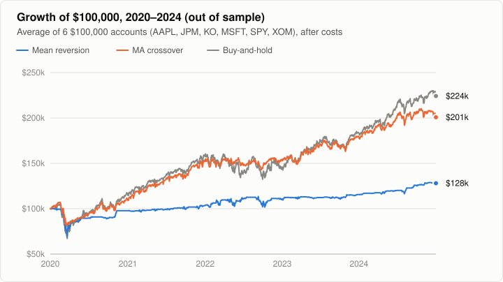
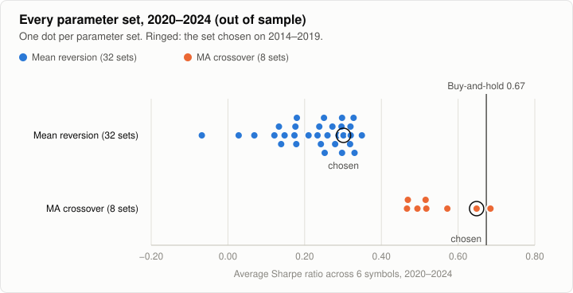
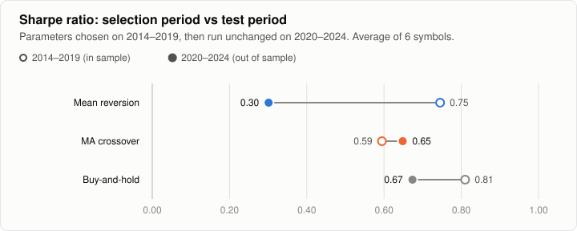
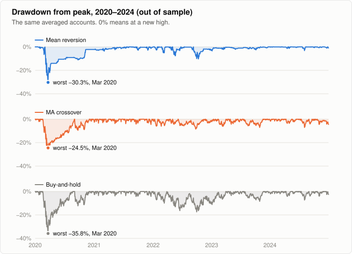
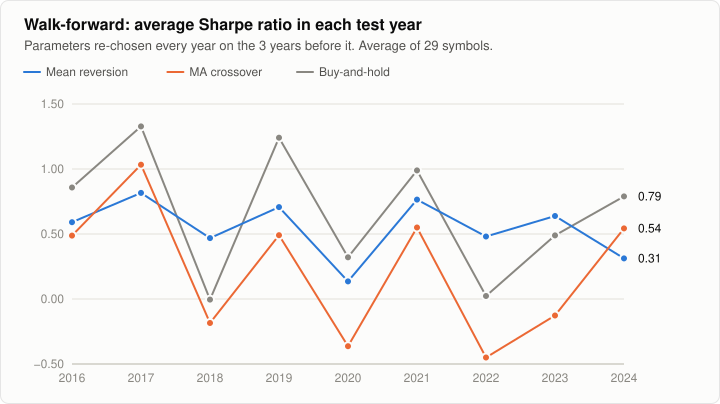

# Barcola

[](https://github.com/Jdaniel98/Barcola/actions/workflows/ci.yml)

A quantitative trading toolkit written from scratch in C++17, used to answer one question: **do two classic trading strategies, buying sharp dips and following trends, beat simply holding the stock?**

**No.** On six large US stocks and ETFs, with parameters chosen on 2014–2019 and tested unchanged on 2020–2024, after trading costs, buying dips fell well short of holding and following trends came close. A robustness study then checked those results against chance, against re-choosing parameters every year, and on 29 Dow stocks picked without hindsight. It confirmed that buying dips loses. Trend following's near-tie turned out to depend on the six hand-picked stocks: on the Dow, and in every year of the walk-forward test, it trailed holding as well. Finally, a pre-registered test on 21 months of data no study had seen (2025–2026) agreed: every strategy trailed holding, and neither proposed fix for buying dips helped reliably.



| 2020–2024, out of sample, average of 6 symbols | CAGR | Sharpe | Max drawdown | Time in market |
|---|---:|---:|---:|---:|
| Mean reversion: buy dips 2 standard deviations below the 20-day average | 4.5% | 0.30 | 33.7% | 24% |
| MA crossover: hold while the 20-day average is above the 200-day | 13.9% | 0.65 | 30.8% | 76% |
| Buy-and-hold | 16.7% | 0.67 | 39.6% | 100% |

## What the study found

**Buying dips lost to holding, whichever settings were used.** None of the 32 mean-reversion parameter sets beat buy-and-hold out of sample, and neither did 7 of the 8 crossover sets. Mean reversion wins often and small: dips that recovered within two weeks won 94% of the time. But it never cuts a loss, and the trades still open after a month were mostly losers. [Phase 3 write-up](docs/phase-3-results.md)



**The selection period pointed the wrong way.** On 2014–2019, a calm and rising market, mean reversion had the better Sharpe ratio. On 2020–2024, with a crash, a bear market and long trends, the ranking reversed. Choosing between strategies on one kind of market would have picked the one that did worse next. [Phase 4 write-up](docs/phase-4-results.md)



**Trend following limited drawdowns, but not in fast crashes.** The crossover's averaged accounts fell 24.5% at worst, against 35.8% for buy-and-hold, but most of that came in March 2020, before a 200-day average could react. Much of its edge comes from one stock: it held no XOM through the 2020 oil collapse and then rode the recovery for a 174% gain.



## How robust is this?

Four checks, on the original six symbols and on the 29 stocks of the Dow Jones index as of January 2014 ([Phase 6 write-up](docs/phase-6-robustness.md)):

| Check | Mean reversion vs buy-and-hold | MA crossover vs buy-and-hold |
|---|---|---|
| Luck: 1,000 block-bootstrap resamples | Behind; ahead in under 5% of resamples in 3 of 4 tests | Tied only in the original test; ahead in under 5% in the other 3 |
| Walk-forward 2016–2024, parameters re-chosen yearly | Ahead in 2–3 of 9 years, including 2018 and 2022, when holding earned about nothing | **Ahead in 0 of 9 years**, on both universes |
| Trading costs from 0× to 3× | Behind even with free trading | Behind even with free trading |
| 29 Dow stocks instead of 6 hand-picked ones | 1.8% a year against 8.6% | 2.9% a year against 8.6% |



The firmest result is that mean reversion, as tested, loses to holding. Neither strategy has a stable best setting: the parameters chosen each year keep changing. And the six original stocks flattered every approach, buy-and-hold most of all (16.7% a year on them, 8.6% on the Dow stocks).

## The fresh-data test

Every rule, parameter and hypothesis was committed and pushed to GitHub before any 2025–2026 prices were downloaded, then tested once on January 2025 to September 2026 ([pre-registration](docs/phase-7-preregistration.md), [results](docs/phase-7-results.md)). It also tested two fixes for mean reversion suggested by the earlier studies: buying dips only above the 200-day average, and selling after 21 trading days.

| Hypothesis | Six symbols | 29 Dow stocks |
|---|---|---|
| Mean reversion trails buy-and-hold | **Supported** | Inconclusive (same direction) |
| MA crossover trails buy-and-hold | Inconclusive (same direction) | **Supported** |
| A 200-day trend filter improves mean reversion | Inconclusive | **Contradicted**: it made it worse |
| A 21-day time stop improves mean reversion | Inconclusive | Inconclusive |

Buy-and-hold returned about 21% a year on both universes; no strategy came close. Twenty-one months is short, so most comparisons are too uncertain to call, as the pre-registration expected.

## How the test was run

| | |
|---|---|
| Symbols | SPY, AAPL, MSFT, JPM, XOM, KO, each backtested on its own with $100,000 |
| Data | Daily prices from Tiingo, adjusted for splits and dividends |
| Selection | One parameter set per strategy, chosen by average Sharpe ratio on 2014–2019 |
| Test | The chosen set run unchanged on 2020–2024, next to buy-and-hold |
| Fills | Decide on the close, fill at the next day's open |
| Costs | 0.1% commission and 5 bps slippage on every buy and sell |
| Look-ahead | Strategies only ever see bars up to the current one |

**Caveats.** The six main symbols are well-known companies chosen with hindsight, which flatters buy-and-hold; the Phase 6 Dow universe checks how much. Idle cash earns no interest. Each symbol has only 16–30 mean-reversion trades and 3–8 crossover trades per period, so the averages across symbols mean more than any single row. And the 2020–2024 period has now been used by both studies, so any new idea built on these findings needs testing on data neither has seen. Details are in the write-ups.

## Reproducing the results

```bash
cmake -B build -DCMAKE_BUILD_TYPE=Release
cmake --build build --parallel
ctest --test-dir build --output-on-failure
scripts/fetch_market_data.sh                   # needs a free Tiingo API token
build/apps/strategy_study data/market results > results/study_output.md

# Phase 6 universe: 29 Dow stocks as of 2014
scripts/fetch_market_data.sh --out data/dow30 $(grep -v '^#' scripts/universes/dow30_2014.txt)
build/apps/strategy_study data/dow30 results/dow30 "29 Dow stocks as of 2014" > results/dow30/study_output.md
```

Each run prints every table in the write-ups and redraws the charts in its `charts/` folder. A rerun reproduces the committed results exactly. Tiingo's terms restrict redistributing its prices, so the downloaded data and the outputs that contain prices (trades and daily equity) are kept out of git.

**Requirements:** a C++17 compiler, CMake 3.16+ and libcurl. The download script needs curl and python3.

### Running the CI checks locally

```bash
pip install clang-format==18.1.8 clang-tidy==18.1.8 gcovr==8.5
scripts/check_format.sh                    # --fix reformats in place
scripts/run_clang_tidy.sh build            # needs a configured build directory

cmake -B build-asan -DCMAKE_BUILD_TYPE=Debug -DBARCOLA_SANITIZE=ON
cmake --build build-asan --parallel && ctest --test-dir build-asan

cmake -B build-cov -DCMAKE_BUILD_TYPE=Debug -DBARCOLA_COVERAGE=ON
cmake --build build-cov --parallel && ctest --test-dir build-cov
gcovr --filter src/ --filter strategies/ --object-directory build-cov --merge-mode-functions=separate
```

`-DBARCOLA_WARNINGS_AS_ERRORS=ON` makes any compiler warning fail the build, as in CI. With Apple clang, add `--gcov-executable "xcrun llvm-cov gcov"` to the `gcovr` command.

## The toolkit

| Module | What it does |
|---|---|
| **Core** | Daily bars kept in date order; CSV import and export with split and dividend adjustment; Yahoo Finance download; date utilities |
| **Indicators** | Simple and exponential moving averages, Wilder's RSI, Bollinger Bands |
| **Analysis** | Deviation from a moving average, return correlation between assets (aligned by date), annualized volatility, block bootstrap |
| **Risk** | Stop-based position sizing with a leverage cap, a volatility-based slippage model |
| **Simulation** | Monte Carlo test of a moving-average crossover on bootstrapped price paths |
| **Backtest** | Long-only engine with next-open fills, commission, slippage, warm-up history and interest on idle cash; Sharpe, Sortino, max drawdown, Calmar and trade statistics |
| **Strategies** | Z-score mean reversion (with optional trend filter and time stop), moving-average crossover, buy-and-hold |
| **Report** | SVG line, panel, dumbbell and strip charts with light and dark themes |

```
src/          core/ indicators/ analysis/ risk/ simulation/ backtest/ report/
strategies/   Strategy implementations
apps/         strategy_study (Phases 3-6) and fresh_data_test (Phase 7)
scripts/      fetch_market_data.sh: Tiingo download; universes/: fixed symbol lists
docs/         Study write-ups
results/      Study outputs and charts
tests/        Google Test suite, one file per module
data/         Small CSV fixtures for tests
```

### Running a backtest

```cpp
#include "backtest/backtest_engine.h"
#include "ma_crossover_strategy.h"

using namespace barcola;

PriceHistory spy("SPY");
spy.loadFromCsv("data/market/SPY.csv");

BacktestConfig config;            // defaults shown
config.initialCapital = 100000.0;
config.commissionRate = 0.001;    // 0.1% of each trade's value
config.slippageBps = 5.0;
config.positionFraction = 1.0;    // share of cash put into each entry
config.riskFreeRate = 0.05;       // earned on idle cash; Sharpe/Sortino hurdle
config.fillTiming = FillTiming::NEXT_OPEN;
config.warmupBars = 0;            // leading bars used only as history

MovingAverageCrossoverStrategy strategy(20, 200);
BacktestResult result = BacktestEngine(config).run(strategy, spy);
// result.annualizedReturn, result.sharpeRatio, result.maxDrawdown, result.trades, ...
```

A strategy implements `evaluate(bars, position)`. It is called after each close, sees only the bars up to that day, and is told whether it is currently holding a position, so it never has to track that itself. Orders fill at the next day's open; `FillTiming::SAME_CLOSE` fills at the signal day's close instead, for comparison.

### Loading data and using indicators

```cpp
#include "analysis/correlation.h"
#include "core/price_history.h"
#include "indicators/rsi.h"

using namespace barcola;

PriceHistory aapl("AAPL");
aapl.loadFromCsv("data/AAPL_2023_sample.csv");

// Latest RSI(14); empty if there are fewer than 15 prices
std::optional<double> rsi = calculateRSI(aapl.getClosingPrices(), 14);

// Correlation of daily returns between two assets, on the dates both have
PriceHistory msft("MSFT");
msft.loadFromCsv("data/MSFT_2023_sample.csv");
double correlation = CorrelationAnalysis(aapl, msft).calculateCorrelation();
```

CSV columns are matched by header name (`Date`, `Open`, `High`, `Low`, `Close`). When an `Adj Close` column is present, all four prices are scaled by `Adj Close / Close`. Each load replaces any bars already loaded, rows are sorted by date, and duplicate dates or malformed numbers raise an error naming the file and line. `fetchHistoricalData` downloads from Yahoo Finance, but Yahoo now restricts that endpoint, so expect an HTTP error and prefer CSV files.

## Engineering

- **214 tests in 20 programs** (Google Test), run in CI on Ubuntu and macOS. Every bug fix comes with a regression test.
- **Strict checks on every push.** Any compiler warning fails the build (`-Wall -Wextra -Wpedantic -Wshadow -Wconversion`). CI also runs the tests under AddressSanitizer and UndefinedBehaviorSanitizer, checks formatting (clang-format) and lint (a focused clang-tidy set), and measures coverage: the tests run 91% of the lines in the library and strategies.
- **Known-value tests for the math.** RSI, correlation, volatility, drawdown, annualized return, Bollinger Bands and the backtest's fills and sizing are checked against hand-calculated or independently computed values.
- **Built to avoid backtest traps.** Strategies cannot see future bars, fills happen the next day, costs apply to every trade, and the engine, not the strategy, is the record of what is held.
- **Reproducible.** Same data, same results, byte for byte. The Monte Carlo simulation uses a fixed seed and a standard-defined generator.

## Roadmap

- [x] **Phase 1:** Foundation hardening (CMake, tests, CI, bug fixes, CSV support)
- [x] **Phase 2:** Backtesting engine (strategy interface, engine, performance metrics)
- [x] **Phase 3:** Mean reversion backtest with documented results ([write-up](docs/phase-3-results.md))
- [x] **Phase 4:** Second strategy (dual MA crossover) + comparison ([write-up](docs/phase-4-results.md))
- [x] **Phase 5:** Charts and a results-first README
- [x] **Phase 6:** Robustness: bootstrap intervals, walk-forward, cost sensitivity, 29 Dow stocks ([write-up](docs/phase-6-robustness.md))
- [x] **Phase 7:** Pre-registered test on fresh 2025–2026 data ([pre-registration](docs/phase-7-preregistration.md), [results](docs/phase-7-results.md))
- [x] **Phase 8:** Release polish: MIT license, stricter CI (warnings as errors, sanitizers, formatting, lint, coverage), v1.0

## License

The code is released under the [MIT License](LICENSE). The market data it downloads is not part of the repository and stays under Tiingo's terms.
