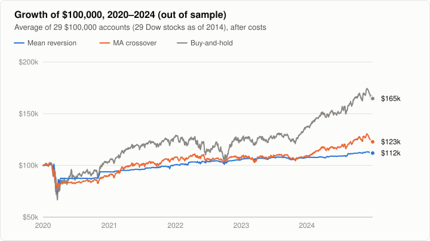

# Phase 6: How Robust Are the Results?

**Question.** Phases 3 and 4 rested on one split of the data (choose on 2014–2019, test on 2020–2024), six hand-picked symbols and one level of trading costs. Which of their conclusions survive chance, re-choosing parameters every year, higher costs, and a universe picked without hindsight?

**Answer.**

- **Mean reversion losing to buy-and-hold survives every check**, on both universes. This is the study's firmest result.
- **The crossover's near-tie with buy-and-hold does not survive.** In the walk-forward test it trailed buy-and-hold in every one of nine years, on both universes. On 29 Dow stocks it lost clearly even in the original 2020–2024 test.
- **Phase 4's "trend following beat dip-buying" came from the six hand-picked stocks.** On the Dow stocks the two strategies are statistically indistinguishable.
- **Trading costs don't change any ranking**, even at zero cost.

All numbers come from [`results/study_output.md`](../results/study_output.md) (six symbols) and [`results/dow30/study_output.md`](../results/dow30/study_output.md) (29 Dow stocks), both produced by `build/apps/strategy_study`. See [Reproducing](#reproducing).

## The four checks

1. **Chance.** A block bootstrap resamples the test period's daily returns in 21-day blocks, 1,000 times, using the same days for every symbol and strategy. It shows how much each Sharpe gap could move by luck.
2. **Walk-forward.** For each year from 2016 to 2024, choose each strategy's parameters on the three years before it, then run them on that year alone. That gives nine test years instead of one test period, with the parameters re-chosen as a trader would.
3. **Costs.** Rerun 2020–2024 with the chosen parameters at 0×, 1×, 2× and 3× the study's costs (1× = 0.1% commission plus 5 bps slippage on every trade).
4. **A broader universe.** The 30 stocks in the Dow Jones Industrial Average on 1 January 2014, a list fixed before seeing any result. It includes laggards such as GE, IBM, XOM and Intel that a hindsight pick would leave out.

## 1. How much is luck

Average Sharpe gap across symbols, and how often the first strategy came out ahead in 1,000 resamples:

| Comparison | 6 symbols, 2020–24 | 6 symbols, walk-forward | 29 Dow, 2020–24 | 29 Dow, walk-forward |
|---|---:|---:|---:|---:|
| Mean reversion minus buy-and-hold | −0.37 (4%) | −0.50 (0%) | −0.21 (15%) | −0.21 (4%) |
| MA crossover minus buy-and-hold | −0.03 (43%) | −0.23 (2%) | −0.23 (4%) | −0.31 (0%) |
| MA crossover minus mean reversion | +0.35 (93%) | +0.27 (97%) | −0.02 (40%) | −0.10 (22%) |

- **Mean reversion trails buy-and-hold everywhere**, and in three of the four tests luck puts it ahead in under 5% of resamples.
- **The crossover only ties buy-and-hold in the one test Phase 4 used.** In the other three it trails, with luck putting it ahead in under 5% of resamples.
- **Which strategy is better depends on the universe.** The crossover leads clearly on the six hand-picked symbols and is no better than mean reversion on the Dow.

## 2. Walk-forward, 2016–2024

Each year's parameters chosen on the three years before it; all nine test years compounded:

| | 6 symbols: CAGR | Sharpe | Years ahead of B&H | 29 Dow: CAGR | Sharpe | Years ahead of B&H |
|---|---:|---:|---:|---:|---:|---:|
| Mean reversion | 3.2% | 0.28 | 2 of 9 | 3.6% | 0.31 | 3 of 9 |
| MA crossover | 9.9% | 0.54 | **0 of 9** | 2.6% | 0.21 | **0 of 9** |
| Buy-and-hold | 17.8% | 0.77 | | 10.4% | 0.52 | |


- **Neither strategy has a stable best setting.** The chosen parameters drift from year to year: mean reversion's lookback moves from 20 to 50 days, and the crossover switches between 50-day and 200-day long averages. A setting that won the previous three years is a weak guide to the next.
- **Mean reversion holds up in bad years.** It beat buy-and-hold in 2018 and 2022 on both universes, the two years in which holding these stocks earned about nothing, and in 2023 on the Dow. That fits a strategy that is in cash about 80% of the time. It just doesn't make up for the good years.
- **The crossover never beat buy-and-hold in any year.** It fell furthest behind in 2019 on both universes (Sharpe 1.10 against 1.92 on the six symbols, 0.49 against 1.24 on the Dow). After the late-2018 sell-off its averages likely signalled "out" for months, so it missed much of the rebound.

## 3. Costs

2020–2024, chosen parameters, average CAGR:

| Costs | 6: MR | 6: MA | 6: B&H | Dow: MR | Dow: MA | Dow: B&H |
|---|---:|---:|---:|---:|---:|---:|
| 0× (free trading) | 5.8% | 14.3% | 16.8% | 2.6% | 3.2% | 8.7% |
| 1× (the study) | 4.5% | 13.9% | 16.7% | 1.8% | 2.9% | 8.6% |
| 2× | 3.3% | 13.7% | 16.6% | 1.1% | 2.7% | 8.6% |
| 3× | 2.0% | 13.3% | 16.6% | 0.3% | 2.4% | 8.5% |

Even with free trading, neither strategy catches buy-and-hold. Mean reversion trades most, so it is the most sensitive, losing about 1 percentage point a year for each extra 1× of costs. The crossover loses about 0.3 points and buy-and-hold almost nothing.

## 4. The broader universe

The 30 Dow stocks of 1 January 2014, minus DD (see [Data notes](#data-notes)), with the same method as Phases 3 and 4:

| 2020–2024, out of sample, average of 29 | CAGR | Sharpe | Max drawdown | In market |
|---|---:|---:|---:|---:|
| Mean reversion (20-day, z 2.5 / 0.5) | 1.8% | 0.22 | 33.0% | 17% |
| MA crossover (50 / 200) | 2.9% | 0.20 | 39.2% | 64% |
| Buy-and-hold | 8.6% | 0.43 | 44.6% | 100% |



- **The six original symbols flattered every strategy, buy-and-hold most of all.** Buy-and-hold made 16.7% a year on them but 8.6% on the Dow. That is the cost of picking today's well-known winners.
- **The crossover lost the most from the broader universe**, falling from 13.9% a year to 2.9%. Its Phase 4 result leaned on a few strong trends: big tech, and XOM's recovery.
- **No parameter set of either strategy beat buy-and-hold's average Sharpe on the Dow** (0 of 32 and 0 of 8). Mean reversion's chosen set ranked 16th of 32 and the crossover's 3rd of 8. By Sharpe ratio, mean reversion beat buy-and-hold on 5 of the 29 stocks and the crossover on 7.

## What it adds up to

| Claim | Verdict |
|---|---|
| Mean reversion as tested underperforms buy-and-hold | **Strong.** Every check, both universes. |
| Trend following matches buy-and-hold | **Not supported.** True only for the six hand-picked stocks in one test period. |
| Trend following beats mean reversion | **Not supported in general.** Depends on the universe. |
| Mean reversion does relatively well in bad years | **Suggestive.** Consistent, but only two or three years. |
| Trading costs explain the shortfall | **No.** The rankings hold even at zero cost. |

## Limits that remain

- **Walk-forward restarts each year.** Every strategy, buy-and-hold included, closes out on 31 December and re-enters in January, paying costs and missing the first day of each year. The treatment is the same for all three, but it lowers every walk-forward number a little.
- **Still large companies that existed in 2014.** The Dow list avoids picking winners, but it has no small companies and none that later went bankrupt.
- **One data vendor and no interest on cash.** Interest would help the strategies that sit in cash: at a 2% rate, mean reversion by roughly 1.5 points a year and the crossover by roughly 0.5 to 0.7.
- **The 2020–2024 period has been used three times now.** The walk-forward test years 2016–2019 were never test data before, though they were in the earlier studies' selection period. For a truly clean test, the next step would be data from 2025 onward.

## Data notes

- **DD is excluded.** Tiingo's adjusted history shows one-day drops of −20.0% on 2017-09-01 (the DowDuPont merger) and −16.9% on 2019-06-03 (the Corteva spin-off and reverse split). These are artifacts of how the corporate actions were recorded, not real losses, and a dip-buying strategy would trade on them. The decision was made from the price data alone, before any strategy was run on the Dow.
- **UTX stays in.** It merged with Raytheon in 2020. Tiingo continues its history as RTX with the Carrier and Otis spin-offs adjusted for, which is what a shareholder would have held.
- **Other spin-offs are adjusted.** I checked GE (twice), 3M, Merck, Pfizer, IBM, AT&T and J&J around each spin-off or exchange date: no artificial drops.

## Reproducing

```bash
cmake -B build -DCMAKE_BUILD_TYPE=Release
cmake --build build --parallel
scripts/fetch_market_data.sh                                                   # six symbols
scripts/fetch_market_data.sh --out data/dow30 $(grep -v '^#' scripts/universes/dow30_2014.txt)
build/apps/strategy_study data/market results > results/study_output.md
build/apps/strategy_study data/dow30 results/dow30 "29 Dow stocks as of 2014" > results/dow30/study_output.md
```

The universe list, with the reasons for DD's exclusion, is in [`scripts/universes/dow30_2014.txt`](../scripts/universes/dow30_2014.txt). The Dow run writes the same files as the six-symbol run into `results/dow30/`.
