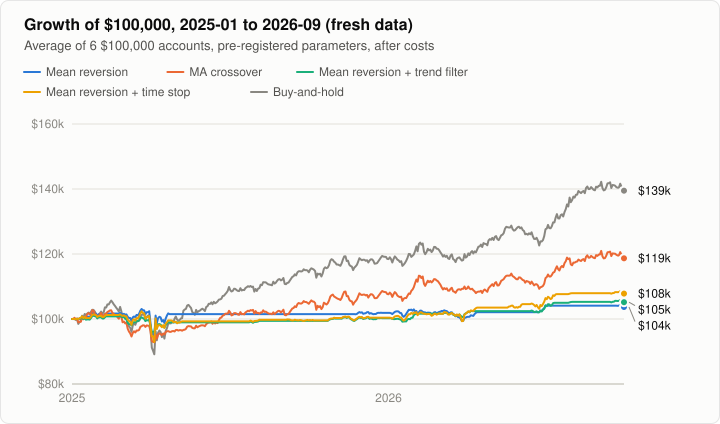
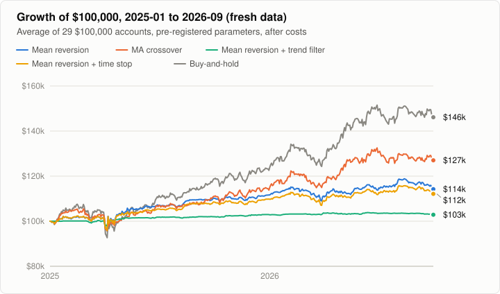

# Phase 7 Results: The Pre-registered Test on Fresh Data

**Question.** Phases 3–6 all used 2014–2024 data. On 21 months none of them had seen, January 2025 to September 2026, do the earlier conclusions hold? And do the two refinements they suggested, a trend filter and a time stop, actually improve mean reversion?

**Answer.**

- **Every strategy trailed buy-and-hold on both universes.** That's two clear verdicts: mean reversion on the six symbols and the crossover on the Dow 29. The other two comparisons with buy-and-hold pointed the same way but were too uncertain to call.
- **Neither refinement reliably helped.** The trend filter made mean reversion *worse* on the Dow, a clear verdict against it. The time stop helped on the six symbols and hurt slightly on the Dow, and neither result was clear.
- **This agrees with Phases 3–6.** As tested, neither buying dips nor following trends beat simply holding these large stocks, and the obvious fixes didn't change that.

Every rule, parameter and hypothesis was fixed in the [pre-registration](phase-7-preregistration.md) before the test data was downloaded.

## The order of events

| When (UTC, 2026-10-17) | What |
|---|---|
| 01:00:30 | Pre-registration committed (`8058082`): hypotheses, rules, chosen parameters |
| 01:02:26 | That commit received by GitHub (repository activity log) |
| 01:06:58–01:07:11 | Test data downloaded from Tiingo into `data/fresh/` |
| after | Test run once per universe |

Before the test ran, I checked the data. All 35 files cover 2023-06-01 to 2026-09-30 with the same 836 trading days. The largest one-day moves include real events such as the April 9, 2025 tariff-pause rally, Intel's September 2025 jump on Nvidia's investment and UnitedHealth's April 2025 guidance cut. The one move I couldn't place, IBM's −25.2% on 2026-07-14, was a real profit warning, IBM's worst day on record ([CNBC](https://www.cnbc.com/2026/07/14/ibm-warns-second-quarter-earnings-fell-short-of-expectations.html)), not a data artifact. No symbol was excluded.

## Verdicts

The measure is the average Sharpe ratio across symbols. "Ahead in" is the share of 1,000 block-bootstrap resamples in which the first strategy beat the second. A hypothesis is supported or contradicted only if one side wins in at least 95% of them.

| | Hypothesis | Six symbols | Dow 29 |
|---|---|---|---|
| H1 | Mean reversion trails buy-and-hold | **Supported**: gap −0.64, ahead in 1.1% | Inconclusive: gap −0.15, ahead in 22.8% |
| H2 | MA crossover trails buy-and-hold | Inconclusive: gap −0.32, ahead in 5.6% | **Supported**: gap −0.33, ahead in 0.2% |
| H3 | The trend filter improves mean reversion | Inconclusive: gap +0.11, ahead in 70.1% | **Contradicted**: gap −0.31, ahead in 2.9% |
| H4 | The time stop improves mean reversion | Inconclusive: gap +0.22, ahead in 91.4% | Inconclusive: gap −0.06, ahead in 5.6% |

## Results

### Six symbols

| Jan 2025 – Sep 2026, average of 6 | Parameters | CAGR | Sharpe | Max DD | In market |
|---|---|---:|---:|---:|---:|
| Mean reversion | 30-day, z 2.5 / 0 | 2.1% | 0.32 | 12.4% | 10% |
| MA crossover | 20 / 200 | 10.3% | 0.63 | 16.6% | 77% |
| Mean reversion + trend filter | 30-day, z 2 / 0 | 2.9% | 0.42 | 8.8% | 10% |
| Mean reversion + time stop | 30-day, z 2 / 0 | 4.4% | 0.53 | 12.2% | 17% |
| Buy-and-hold | | 21.1% | 0.95 | 22.9% | 100% |



### Dow 29

| Jan 2025 – Sep 2026, average of 29 | Parameters | CAGR | Sharpe | Max DD | In market |
|---|---|---:|---:|---:|---:|
| Mean reversion | 50-day, z 1 / 0.5 | 7.5% | 0.52 | 18.9% | 37% |
| MA crossover | 20 / 200 | 12.3% | 0.33 | 23.1% | 70% |
| Mean reversion + trend filter | 30-day, z 2.5 / 0.5 | 1.5% | 0.21 | 6.6% | 7% |
| Mean reversion + time stop | 50-day, z 1 / 0.5 | 6.3% | 0.46 | 18.4% | 33% |
| Buy-and-hold | | 20.8% | 0.66 | 26.6% | 100% |



## What the results show

**Holding was hard to beat in this period.** Buy-and-hold returned about 21% a year on both universes. Strategies that sit in cash much of the time, as all three mean-reversion versions do, give up most of that.

**The trend filter mostly stopped mean reversion from trading.** On the Dow it cut trading to 1.4 trades per stock and 7% time in the market. Meant to avoid buying into declines, in practice it avoided buying at all, and it lost to plain mean reversion clearly. On the six symbols it nudged results up, but not clearly.

**The time stop's effect depended on the universe.** It helped on the six symbols, where it came out ahead in 91% of resamples, close to but short of the 95% bar. It slightly hurt on the Dow, coming out ahead in only 6%. With these few months of data, neither result is clear.

**Exploratory, not pre-registered:**
- On the Dow, the time-stopped version beat the trend-filtered one in 95.8% of resamples. That comparison was not one of the four hypotheses.
- Mean reversion's gap to buy-and-hold on the Dow (−0.15) was its smallest in any test so far.

These findings could guide another fresh test. They aren't conclusions.

## Deviations from the pre-registration

**One code change after the download, cosmetic and disclosed as promised.** The growth charts' legends had five long labels that ran past the chart's edge, so legends now wrap onto a second row. No number changed: both test reports came out byte-identical before and after the change, and every earlier chart is unchanged. The change is in `src/report/svg_chart.cpp`, in the commit that adds these results.

Nothing else changed: the universes, the parameters in `apps/preregistration.h`, the hypotheses and the rule for judging them are exactly as registered.

## Limits

- **21 months is short.** The 95% ranges are wide, and most verdicts are inconclusive, as the pre-registration expected.
- **One market environment.** The period is mostly a strong rally after the April 2025 tariff sell-off, which favors staying invested. A sideways or falling market could rank the strategies differently.
- **The same simplifications as before:** each stock is tested on its own, idle cash earns no interest, and costs are fixed at 0.1% commission plus 5 bps slippage.

## Reproducing

```bash
scripts/fetch_market_data.sh --out data/fresh/market --from 2023-06-01 --to 2026-09-30
scripts/fetch_market_data.sh --out data/fresh/dow30 --from 2023-06-01 --to 2026-09-30 \
    $(grep -v '^#' scripts/universes/dow30_2014.txt)
build/apps/fresh_data_test run data/fresh/market results/phase7/six six > results/phase7/six/test_output.md
build/apps/fresh_data_test run data/fresh/dow30 results/phase7/dow29 dow29 > results/phase7/dow29/test_output.md
```

Full outputs: [`results/phase7/six/test_output.md`](../results/phase7/six/test_output.md) and [`results/phase7/dow29/test_output.md`](../results/phase7/dow29/test_output.md). Tiingo revises adjusted prices when new dividends are paid, so a later download can differ very slightly.
